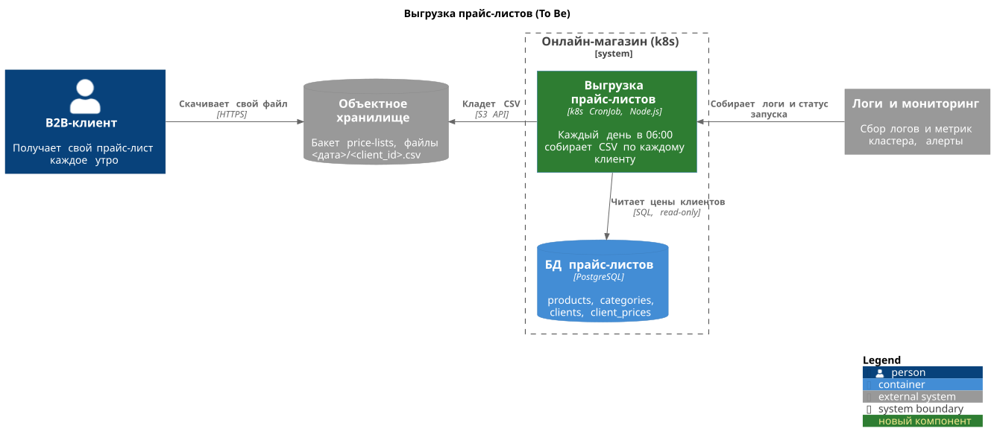

# Задание 2: выгрузка прайс-листов

## Сравнение

| | Spring Batch | Apache Airflow | K8s CronJob | Spark |
| :- | :- | :- | :- | :- |
| Наличие конфигурации CRON-расписания | Своего нет (нужны к примеру Spring Scheduler, Quartz) | Да | Да | Нет, нужен внешний запуск |
| Сложность реализации логики по обработке данных | Сложно, слишком много кода для одного SELECT (Job, Step итд) | Низкая | Низкая (скрипт с запросом) | Высокая для такой задачи |
| Ресурсоемкость решения (количество потребляемых ресурсов) | JVM и таблицы JobRepository | Постоянно работают планировщик, веб-сервер, БД метаданных | Один под на пару минут в день | Кластер |
| Масштабируемость решения под нагрузкой и сложность реализации | Partitioning (здесь не нужен) | Воркеры | При таком объеме не нужно | Лучшая, но нужна для гораздо больших объемов |
| Сложность развертывания в облаке и интеграция с имеющейся микросервисной  архитектурой | Образ, планировщик и БД для JobRepository | Избыточная: отдельный стек, который нужно поднимать | Манифест в тот же кластер | Отдельный кластер или оператор |
| Логи и мониторинг | Micrometer, Actuator | UI, логи задач | Логи пода и статус Job, как у остальных сервисов | Spark UI |

## Вывод

Лучше всего подходит K8s CronJob. Задача - раз в сутки выполнить один запрос и разложить результат по файлам. Логики обработки и зависимостей между шагами нет, объем маленький (до 20 тыс. строк цен). Поэтому ретраи отдельных шагов и масштабирование не нужны: упавший запуск проще перезапустить целиком.

Магазин уже работает в k8s, и CronJob не добавляет новой инфраструктуры: тот же деплой, те же логи и метрики. Airflow или Spark пришлось бы поднимать ради одной задачи, Spring Batch дал бы лишний код и таблицы JobRepository.

## Как работает

1. В 06:00 CronJob создает Job, который запускает под с образом (логика выгрузки).
2. Скрипт одним запросом забирает цены всех клиентов: `client_prices` с join на `products`, `categories` и `clients`.
3. Прайс-листы кастомные, поэтому на каждого клиента свой CSV. Файлы кладем в бакет `price-lists` как `<дата>/<client_id>.csv`, клиент скачивает свой.
4. Под завершает работу. Логи пода собираются так же, как у остальных сервисов в кластере, статус Job виден в мониторинге.
5. Если к 06:30 нет успешного запуска, приходит алерт.

## План внедрения

1. Реализация скриптов выгрузки на Node.js: запрос с join таблиц, группировка по клиенту, генерация CSV на клиента, загрузка файлов в бакет.
2. Настроить доступы: пользователь БД только на чтение и ключ к бакету только на запись, оба в k8s Secret.
3. Dockerfile, сборка в CI, образ в registry.
4. Манифест CronJob: `schedule: "0 6 * * *"` с `timeZone` магазина, `concurrencyPolicy: Forbid`, `backoffLimit: 2`, небольшие requests/limits по памяти.
5. Настроить мониторинг: логи и алерты.
6. Проверка на стейджинге: запустить вручную, сверить файлы пары клиентов с ценами в БД.
7. Прод: применить манифест.