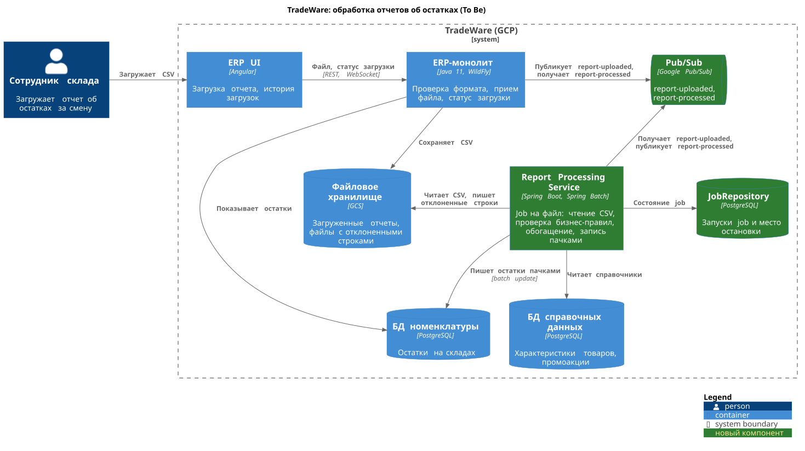

# ADR: Пакетная обработка отчетов об остатках

## Контекст

Склады загружают отчеты об остатках в CSV, до 400 тыс. строк в сутки, в пиковые дни в 2-3 раза больше. Сейчас отчет обрабатывает монолит прямо в запросе загрузки:
- пользователь ждет, пока обработается весь файл
- остатки обновляются по одной строке, на каждую строку выполняются запрос и транзакция, в пик это перегружает БД
- обработка идет в том же монолите, что и интерфейс ERP (отображение остатков итд), поэтому в пик тормозит все остальное
- если обработка упала на середине, файл перезаливают целиком, а причину ищут по логам в файле.

Нужно
- держать 100-150 параллельных загрузок в пик
- обрабатывать отчет на 2000 строк в среднем до 30с
- начать выносить функционал из монолита в отдельные микросервивы.

## Рассмотренные варианты

### Отдельный микросервис на Spring Batch

1. Монолит проверяет формат файла. Если неправильный, сразу показывает ошибки. Если корректный, то кладет CSV в хранилище, публикует `report-uploaded` в Google Pub/Sub и отвечает, что отчет принят в работу.
2. Новый Report Processing Service получает событие и запускает job на этот файл. На каждый чанк:
   - reader читает CSV из GCS
   - processor проверяет бизнес-правила и обогащает строки справочными данными (которые грузятся в память один раз на весь job)
   - writer пишет всю пачку строк в БД номенклатуры одним запросом (одна транзакция на пачку). Строки с ошибками пропускаются.
3. Упавший job перезапускается с последнего записанного чанка (состояние джоб в JobRepository).
4. В конце сервис публикует `report-processed`: статус (успех или ошибка), сколько строк применено и отклонено. Монолит обновляет статус загрузки и уведомляет пользователя.
5. Сервис работает в нескольких экземплярах, подписка Pub/Sub раздает файлы между ними. В пик сообщения просто ждут в очереди, монолит этого не замечает (не мешает прочей логике). На пики нагрузки масштабируется.

### Airflow

DAG запускается на каждый загруженный файл (шаги проверки, обогащения и записи). Есть готовые операторы GCP, UI и ретраи. Но DAG и операторы пишутся на Python, а команда проекта пишет на Java. Сама обработка строк все равно остается собственной, Airflow ее только запускает. Слишком сложный стек для данной задачи. Под 150 параллельных запусков нужен большой кластер (много воркеров, работающих параллельно).

### Spring Cloud Data Flow

Тот же код на Spring Batch, только запускает его платформа SCDF: на каждое событие `report-uploaded` она стартует отдельную задачу (под в Kubernetes). Из коробки есть UI и REST для запуска и перезапуска, история запусков, версии приложений. Но тогда ради одного типа job придется поднимать и поддерживать всю платформу: Data Flow Server, Skipper, их БД и Kubernetes, которого у TradeWare пока нет. Каждый файл - новый под и старт JVM, в пик это 150 подов одновременно.

## Сравнение альтернатив

| Вариант решения | Преимущества | Недостатки |
| :- | :- | :- |
| Spring Batch | - Java и Spring, привычные команде - Запись пачками вместо построчной - Рестарт с места остановки, история запусков - Масштабируется числом экземпляров | - Новый сервис, БД JobRepository и Pub/Sub, их надо поддерживать - Параллельные job конкурируют за БД номенклатуры, число экземпляров нужно ограничить |
| Airflow | - UI, ретраи, готовые операторы GCP - Подойдет, если пайплайнов станет много | - Python - Обработку все равно нужно писать отдельно - Дорогой кластер под пиковую параллельность |
| SCDF | - Тот же Spring Batch - UI, история и перезапуск из коробки - Удобно, когда job много | - Целая платформа ради одного job - Нужен Kubernetes - Под и старт JVM на каждый файл, в пик 150 подов |

## Принятое решение

Отдельный сервис на Spring Batch.

У TradeWare один тип файлов, и проблема в том, как он обрабатывается: построчно и внутри монолита.

Spring Batch решает проблему: выполняет запись пачками, рестарт, отдельное масштабирование. Сервис пишется на привычном команде стеке и становится первым шагом выноса функционала из монолита. Остальные варианты на данный момент являются избыточными.
