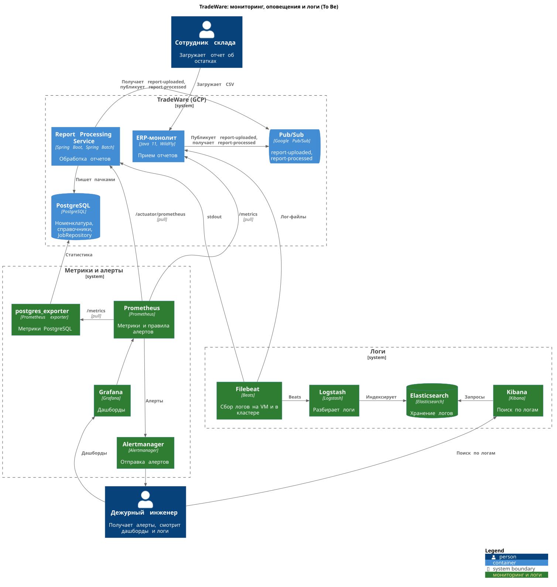

# ADR: Мониторинг, оповещения и логи

## Контекст

Сейчас у TradeWare есть только логи монолита в файле и стандартный мониторинг ресурсов VM и WildFly. Когда обработка отчета падает или тормозит, трудно найти причину и свести логи и метрики в одну картину. После выноса обработки в Report Processing Service логи одной загрузки лежат сразу в двух разных местах (т.к. два сервиса), а время обработки отчета (до 30 с на 2000 строк) не замеряется.

## Решение

Prometheus
 - собирает метрики (каждые в 15 с пуллит их по HTTP у монолита, у Report Processing Service и у postgres_exporter)
 - хранит правила алертов и триггерит их при наступлении условий

Grafana
 - дашборды (данные берет у Prometheus)

Alertmanager
 - группирует сработавшие алерты и отправляет дежурному (Slack, почта)

Логи собираются в ELK: Filebeat, Logstash, Elasticsearch и Kibana.

## Метрики

### API загрузки в монолите - RED

Монолит отдает метрики через `/metrics` WildFly.
- Rate - число загрузок отчетов в минуту
- Errors - доля ответов 5xx и ошибок отчетов (неправильный формат)
- Duration - время ответа на загрузку отчета

### Обработка отчетов в Report Processing Service

Метрики Spring Batch отдает через Micrometer.
RED тут не подходит (нет API). 
- Длительность выполнения джобы, с метками: имя джобы, статус (успех или ошибка)
- Счетчики принятый и невалидных строк при обработке

### Ресурсы - USE

- PostgreSQL (через postgres_exporter): соединения, блокировки
- JVM сервиса: память, CPU.

## Алерты

| Алерт | Условие | Важность |
| :- | :- | :- |
| ReportJobFailed | ошибки выполнения джоб (больше 0) | critical |
| ReportJobSlow | чрезмерно растет длительность выполенния джоб (дольше 30 секунд) | warning |
| DbConnectionsHigh | занято больше 80% соединений PostgreSQL (в течение 5+ минут) | warning |

Пороги нужно будет поправить после нагрузочного тестировния.
Реакция на уровень алерта разная. Critical уходит сразу в Slack и на почту (в перспективе может и звонить), warning только в Slack.
Alertmanager группирует алерты по названию, чтобы при сбое не пришла куча одинаковых сообщений.

## Логи

Приложения логи никуда не отправляют сами за это отвечает агент Filebeat:
- монолит продолжает писать в файл
- Report Processing Service пишет логи в stdout в JSON

Logstash разбирает логи (строки монолита мапит в те же поля, что и JSON сервиса в stdout), и пишет в Elasticsearch.
Индекс можно делать на каждый день. ILM удаляет индексы старше определенного срока (для начала можно поставить месяц).

В логах должны обязательно быть:
- `uploadId` (по нему виден сквозной путь отчета)
- `jobExecutionId` (по нему видна джоба для отчета)
